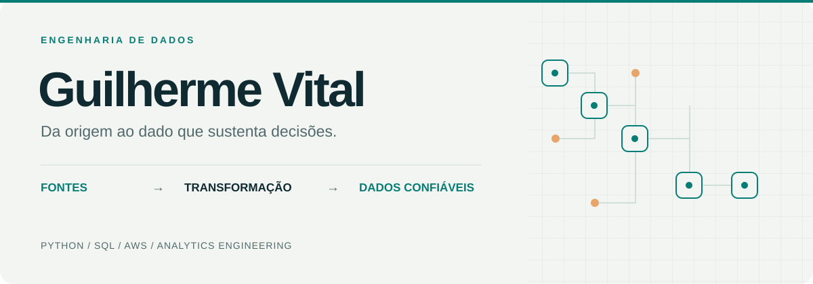

<picture>
  <source media="(prefers-color-scheme: dark)" srcset="assets/profile-data-dark.svg" />
  <source media="(prefers-color-scheme: light)" srcset="assets/profile-data-light.svg" />
  
</picture>

  <a href="https://www.linkedin.com/in/guilherme-vital-rodrigues/">LinkedIn</a> &nbsp; / &nbsp;
  <a href="https://guivital1.github.io/aws-financial-data-pipeline/">Dashboard financeiro</a> &nbsp; / &nbsp;
  <a href="https://github.com/MUSICAS-DO-BRASIL/muv-royalties-ops">Royalties &amp; automação</a>

### Dados com contexto. Engenharia com propósito.

Sou **Guilherme Vital**, estudante de Engenharia de Software na FIAP, com atuação em Data & Analytics na MUV Capital e foco em **engenharia de dados**. Construo pipelines, automações financeiras e produtos analíticos com atenção à qualidade, à rastreabilidade e às regras do negócio.

Meu interesse está no caminho completo: entender a fonte, transformar com critério, modelar para consumo e tornar cada resultado verificável.

<!-- profile-focus:start -->

<code>data engineering</code> &nbsp; <code>analytics engineering</code> &nbsp; <code>event-driven systems</code> &nbsp; <code>financial automation</code>

<!-- profile-focus:end -->

### Projetos em destaque

<table>
<tr>
<td width="50%" valign="top">
<h3>01 / Financial Data Pipeline</h3>

Dados oficiais do Banco Central em um produto analítico: ingestão, camadas Bronze/Silver/Gold, modelos dimensionais e qualidade de dados.

<code>Python</code> <code>AWS</code> <code>dbt</code> <code>DuckDB</code> <code>Airflow</code>

<a href="https://github.com/guivital1/aws-financial-data-pipeline"><strong>Código e arquitetura →</strong></a> 
<a href="https://guivital1.github.io/aws-financial-data-pipeline/">Explorar dashboard</a>
</td>
<td width="50%" valign="top">
<h3>02 / MUV Royalties Ops</h3>

Engenharia aplicada à operação de royalties: leitura de arquivos, staging, validação, normalização e conciliação financeira com rastreabilidade.

<code>Python</code> <code>ETL</code> <code>Docker</code> <code>Data quality</code>

<a href="https://github.com/MUSICAS-DO-BRASIL/muv-royalties-ops"><strong>Conhecer o projeto →</strong></a> 
<a href="docs/music-royalties.md">Ler o case de engenharia</a>
</td>
</tr>
<tr>
<td width="50%" valign="top">
<h3>03 / PIX Sentinel</h3>

Pipeline de eventos de pagamentos sintéticos com contrato de schema, deduplicação por microbatch, recuperação de DLQ e observabilidade.

<code>SQS</code> <code>Lambda</code> <code>S3</code> <code>Athena</code> <code>CloudWatch</code>

<a href="https://github.com/guivital1/pix-sentinel"><strong>Código e decisões técnicas →</strong></a> 
<a href="https://guivital1.github.io/pix-sentinel/">Explorar monitor de risco</a>
</td>
<td width="50%" valign="top">
<h3>04 / Credit Risk Intelligence</h3>

Workflow reproduzível de machine learning com validação de schema, avaliação de modelos, monitoramento de drift e governança.

<code>Python</code> <code>SageMaker</code> <code>MLflow</code> <code>MLOps</code>

<a href="https://github.com/guivital1/credit-risk-intelligence"><strong>Código e evidências →</strong></a> 
<a href="https://guivital1.github.io/credit-risk-intelligence/">Explorar dashboard</a>
</td>
</tr>
</table>

### Como penso os dados

| Etapa | O que procuro garantir | Evidência no portfólio |
| :--- | :--- | :--- |
| **Ingestão** | Origem identificável e contratos de entrada | BCB API, arquivos operacionais e eventos sintéticos |
| **Transformação** | Regras explícitas, validação e normalização | Python, dbt e conciliação de royalties |
| **Modelagem** | Estruturas que facilitam análise e consumo | Dimensões, fatos e marts em DuckDB/dbt |
| **Operação** | Falhas visíveis e recuperação documentada | CI, CloudWatch, DLQ e ensaios de restauração |
| **Entrega** | Dados compreensíveis para quem decide | SQL, dashboards e documentação de negócio |

### Caixa de ferramentas

**Dados:** Python · SQL · Pandas · NumPy · dbt · DuckDB · PostgreSQL 
**Cloud e operação:** AWS S3 · Lambda · Glue · Athena · SQS · CloudWatch · Airflow · Docker · GitHub Actions 
**Base de software:** TypeScript · React · C# · testes automatizados · contratos entre componentes

<strong>Outros estudos e aplicações</strong>

- [Hospital CRM Analytics](https://github.com/guivital1/hospital-crm-analytics) — operação em SQLite, indicadores e otimização de agenda.
- [Cartola Data Analysis](https://github.com/guivital1/cartola-data-analysis) — análise exploratória, estatística e visualização de dados esportivos.
- [Sampling Methods Lab](https://github.com/guivital1/sampling-methods-lab) — comparação de amostragens com transações financeiras sintéticas.
- [Movimenta Optimization](https://github.com/guivital1/movimenta-optimization) — apoio à decisão e otimização de rotina.

### Em movimento

<!-- portfolio-radar:start -->

Profile checked 2026-10-19 · latest data-oriented repos 
<a href="https://github.com/guivital1/ia-ml---checkpoint"><code>ia-ml---checkpoint</code></a> new data project · updated 2026-09-12 
<a href="https://github.com/guivital1/credit-risk-intelligence"><code>credit-risk-intelligence</code></a> Governed credit-risk MLOps with SageMaker evidence, drift monitoring and responsible-use boundaries. · updated 2026-08-24 
<a href="https://github.com/guivital1/pix-sentinel"><code>pix-sentinel</code></a> Reliable event-driven PIX fraud detection with idempotency, DLQ recovery and CloudWatch observability. · updated 2026-08-24

<!-- portfolio-radar:end -->

---

<strong>Transformar dados em confiança, contexto e decisão.</strong> Guilherme Vital · São Paulo, Brasil · Engenharia de Software @ FIAP

