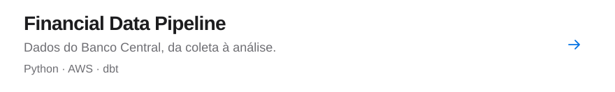
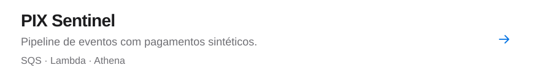
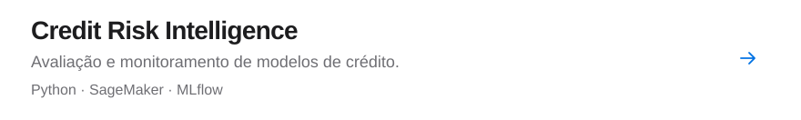

  

  <a href="https://github.com/guivital1/aws-financial-data-pipeline">
    <picture>
      <source media="(max-width: 600px)" srcset="assets/project-financial-compact.svg" />
      
    </picture>
  </a>

  <a href="https://github.com/guivital1/pix-sentinel">
    <picture>
      <source media="(max-width: 600px)" srcset="assets/project-pix-compact.svg" />
      
    </picture>
  </a>

  <a href="https://github.com/guivital1/credit-risk-intelligence">
    <picture>
      <source media="(max-width: 600px)" srcset="assets/project-credit-compact.svg" />
      
    </picture>
  </a>

  <a href="https://www.linkedin.com/in/guilherme-vital-rodrigues/">
    <picture>
      <source media="(max-width: 600px)" srcset="assets/contact-linkedin-compact.svg" />
      
    </picture>
  </a>
  <a href="https://github.com/guivital1?tab=repositories">
    <picture>
      <source media="(max-width: 600px)" srcset="assets/contact-repositories-compact.svg" />
      
    </picture>
  </a>

